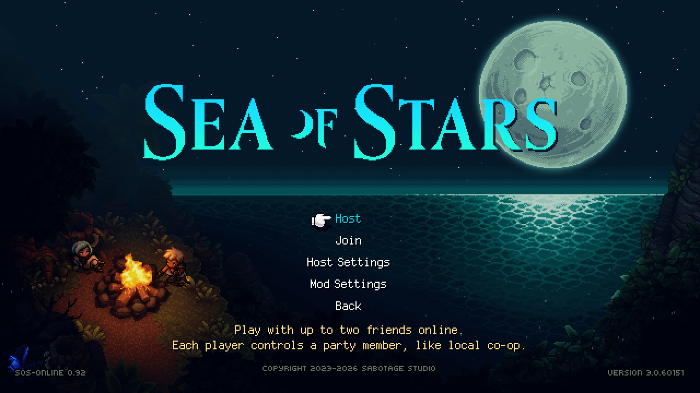
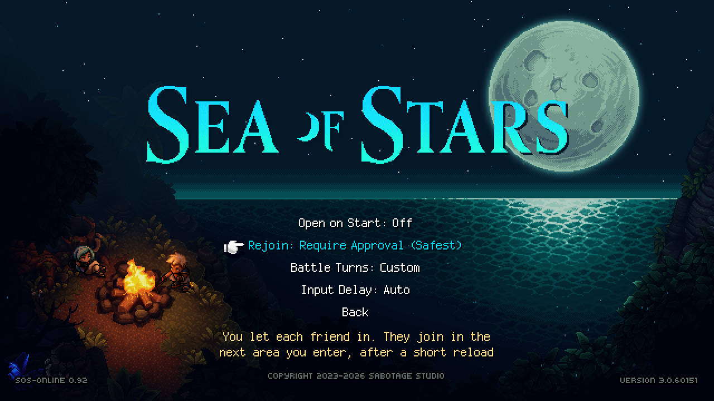
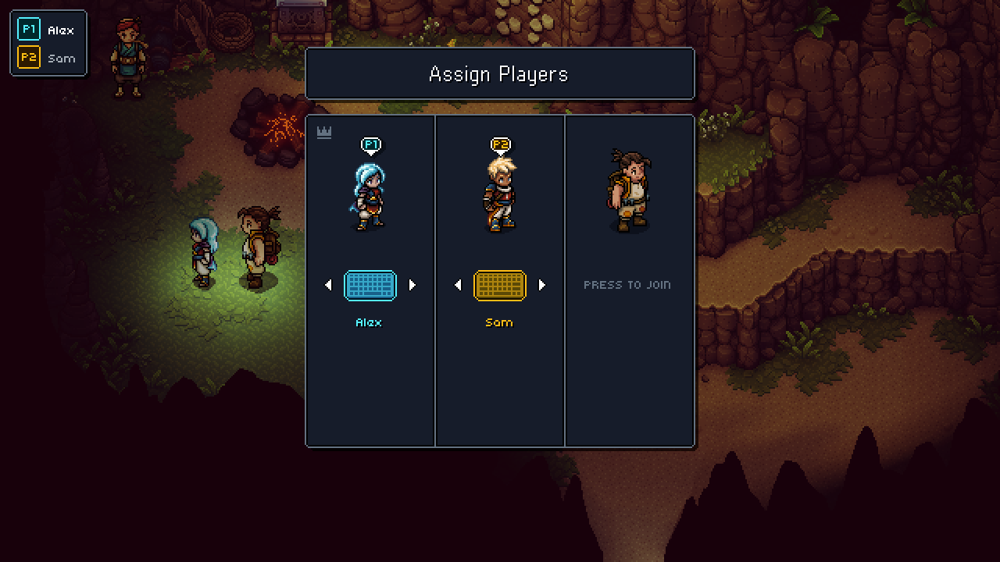
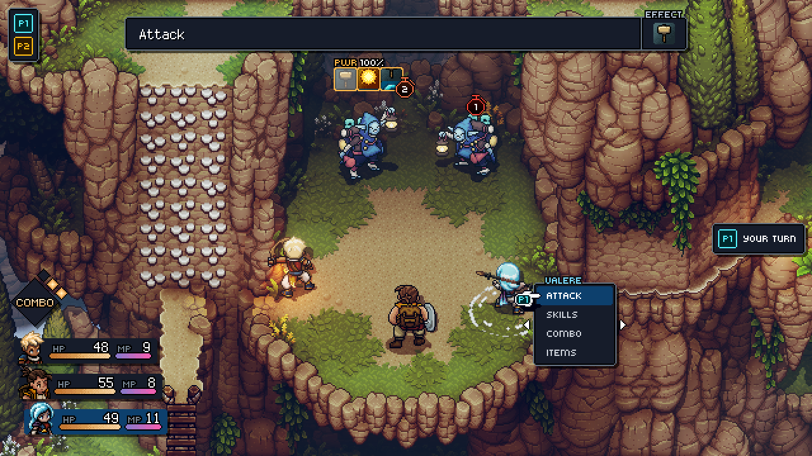
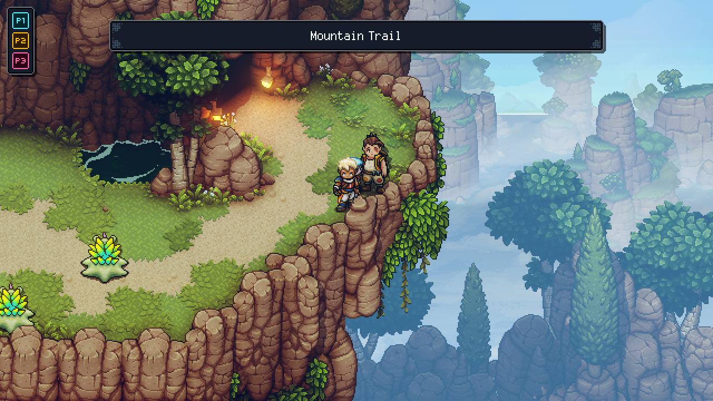
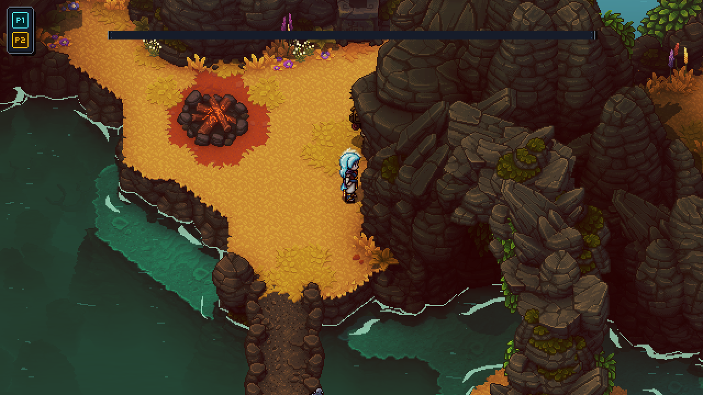

# Sea of Stars Online Co-op

Play **Sea of Stars: Sunset Edition** co-op online with your Steam friends. The game already has local co-op for up to three players; this mod lets players 2 and 3 join from their own PCs.

## Features

- **Up to three players** over Steam, using the game's own co-op. To the game, your friends are simply players 2 and 3.
- **Drop in, drop out.** Friends join a game in progress from a Steam invite or the friends list and take a party member; anyone can leave while the others keep playing.
- **Timed hits and blocks feel right online.** Each press is judged by when you made it, not when it reached the other PCs.
- **Native menus.** An **Online** entry on the title screen and pause menu, built from the game's own widgets.
- **Your saves stay yours.** Friends play on a copy of the host's save; their own saves are never touched.
- **Fixes itself.** If a friend's game gets out of sync, it corrects itself or rejoins in a few seconds.
- **Signed updates, on your terms.** The title screen shows the mod's version and says when an update is available; you choose when to install it.

## Screenshots

| | |
|---|---|
|  |  |
|  |  |
|  |  |

## Installation

> [!WARNING]
> The only official download is the [Releases page](https://github.com/miguelguzmanr/sos-online/releases/latest) of this repository.

Everyone in a session needs **the same version of the mod** and of the game. Install it once; after that, update from the game's **Online** menu.

You need Sea of Stars on Steam (Windows) and `SosOnline-<version>.zip` from the [latest release](https://github.com/miguelguzmanr/sos-online/releases/latest).

1. **Install BepInEx 6 (IL2CPP).** Download [BepInEx-Unity.IL2CPP-win-x64-6.0.0-be.793](https://builds.bepinex.dev/projects/bepinex_be/793/BepInEx-Unity.IL2CPP-win-x64-6.0.0-be.793%2Bdbc82f0.zip) and extract it into the game folder, next to `SeaOfStars.exe`. To find the folder: Steam → right-click Sea of Stars → *Manage* → *Browse local files*.
2. **Start the game once from Steam** and wait for the title screen. The first start takes a minute or two longer while BepInEx prepares itself; a console window opens next to the game. Then quit.
3. **Extract the mod zip** into the same game folder. It adds `BepInEx\plugins\SosOnline\SosOnline.dll`.
4. Start the game from Steam. The title screen now has an **Online** entry.

Updates

The bottom-left corner of the title screen shows the mod's version, e.g. *sos-online 0.73*, and shows *(\<version\> available)* when there's a newer release. Nothing is downloaded until you ask:

1. Title screen → **Online** → **Mod Settings** → **Check for Updates** → **Install**. The update is installed only if its signature matches.
2. **Restart** (through Steam), or **Later**: it runs from the next start.

At start the mod makes one request to GitHub to see whether there's a newer release; nothing personal is sent.

Updating by hand, uninstalling

- To update by hand, extract the new zip over the old one.
- To uninstall, delete `BepInEx\plugins\SosOnline`. To remove BepInEx too, delete `winhttp.dll` from the game folder.

## Playing

**Start from your own game.**
1. **Host:** pause → **Online** → **Open**, then **Invite**.
2. **Friend:** accept the invite, or use **Join Game** in the Steam friends list.
3. **Host:** pause → **Let Robin In**. When the party next enters an area, everyone holds still for a moment and reloads, and the friend takes a party member. **Return to Area Start** (same pause screen) lets them in at once; the area starts over.

The host's **Online** → **Host Settings** → **Rejoin** decides how friends join: **Require Approval (Safest)**, the default, as above; **Auto (Experimental)**, the same without asking; **Off** only while the host is on the title screen. **Open on Start** opens your game to friends every time it starts.

**Or start together:** title screen → **Online** → **Host**; friends join, then **Load Game** and pick a save.

**During a session:**
- **Pause** (Start / Esc) pauses only your screen; the game keeps running for everyone. **Pause for Everyone** opens the game's own pause menu on every PC, e.g. for **Assign Players** (choose who plays whom).
- **Battles:** each player takes the turns of their own character, and a notice on the right says whose turn it is. The host can switch back to the game's own random turns in **Online** → **Host Settings** → **Battle Turns** → **Original**.
- The players and their connection show in the top-left corner. **Status Bar** (pause → **Options**, or **Online** → **Mod Settings**) hides it during play (**Off**) or adds a detailed line (**Advanced**).
- **Leave Co-op** (pause screen): your character goes back to the party AI and the others keep playing. The host's **End Co-op** ends it for everyone.
- If a friend loses the connection, their game reconnects by itself for a minute and rejoins like above.
- **Host:** pause → **Players** removes a player. In a battle, Start opens a host page to take a stuck turn (**Take This Turn**) or pass it to the next player.
- Use a gamepad or keyboard; the mouse is not synchronized.
- Saves made during co-op are the host's. Options (volume, display) stay each PC's own.

**Backups.** The mod keeps old versions of your saves, so a save that gets overwritten isn't lost. They're in your save folder (`%USERPROFILE%\AppData\LocalLow\Sabotage Studio\Sea of Stars`), under `SosOnlineBackup`:
- `Saves`: earlier versions of each of your save files (the last 50, plus one per day for 30 days).
- `Session saves`: the same for the host's saves your game played during co-op.
- `Sessions`: the saves as they were when co-op started, ended, or got out of sync.

To go back to one, quit the game and copy the file over the one in the save folder, renamed to its original name (for example `Autosave_SOS_SaveSlot0.sos`).

## Known limitations

- A friend joining mid-session waits until the party enters a new area (or the host returns to the area start); then everyone holds still for a moment and sees a short fade.
- If the host leaves, the session ends.
- If one PC can't keep 60 fps, everyone slows down with it.
- Tested mostly on one PC with several game instances; real sessions over Steam are still being shaken out. Reports are welcome.

## Something went wrong?

**Friends:** choose **Send Logs to Host** (pause screen, or title screen → **Online** → **Mod Settings**). Your game sends your recent logs, a copy of the session's save, and a crash dump if the game crashed, to the host only.

**Host:** press **F8** → **Open logs folder** (or title screen → **Online** → **Mod Settings** → **Open Logs Folder**), and attach the newest `sosonline-*.log` and `state-*.log` to an [issue](https://github.com/miguelguzmanr/sos-online/issues), with roughly what happened and when. The logs contain the Steam names of the players in the session; nothing else personal.

## Credits

- [BepInEx](https://github.com/BepInEx/BepInEx), [Il2CppInterop](https://github.com/BepInEx/Il2CppInterop) and [HarmonyX](https://github.com/BepInEx/HarmonyX), which make the mod possible.
- [Sabotage Studio](https://sabotagestudio.com/), for Sea of Stars and its local co-op. This mod is unofficial and not affiliated with Sabotage Studio.

---

Building from source, how it works and how it's tested: see [CLAUDE.md](CLAUDE.md).
